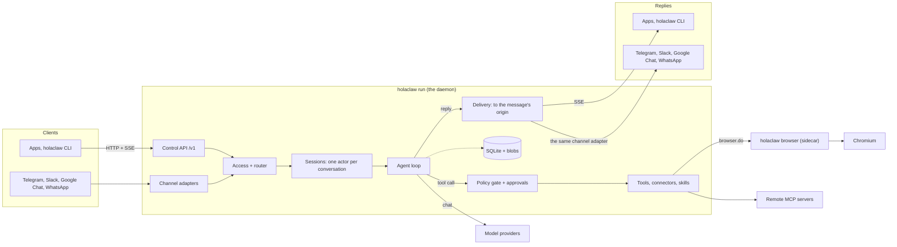

# Architecture

How HolaClaw is built: the processes, the path of a message, the components
and where their state lives. Each part links to the doc that covers it in
full; this file is the map.

## Contents

1. [What HolaClaw is](#1-what-holaclaw-is)
2. [The big picture](#2-the-big-picture)
3. [Components](#3-components)
4. [State](#4-state)
5. [Rules that cut across](#5-rules-that-cut-across)
6. [Extension points](#6-extension-points)
7. [Stability contract](#7-stability-contract)
8. [Code map](#8-code-map)

## 1. What HolaClaw is

HolaClaw is an agent harness in a single Go binary. A daemon runs agents that
people talk to from chat apps, the HolaClaw apps and the terminal. An agent
calls a model, uses tools behind a policy gate, remembers, runs scheduled
tasks and drives a browser.

Five principles shape it:

- **Minimal.** A feature earns its place: every addition justifies the prompt
  tokens and the config keys it costs.
- **Efficient.** The fixed part of every prompt is a measured, enforced
  budget. What works on a small model with an 8k window works everywhere.
- **Model-neutral.** One provider interface; what a model can do is declared,
  never assumed.
- **Traceable.** One trace follows a message from the moment it arrives to the
  reply, across model calls, tools, approvals and tasks.
- **Stable.** Config, API, events and database are versioned, and old configs
  always migrate.

## 2. The big picture

Two processes run from the same binary: the **daemon** (`holaclaw run`), which
holds everything, and the optional **browser sidecar** (`holaclaw browser`),
which owns Chromium under its own user. Everything else is a client: the
`holaclaw` CLI talks to the daemon over its API, as the apps do.

**The life of a message:**

1. A **channel adapter** turns a platform message into an envelope: who sent
   it, in which conversation and thread, with which attachments. The API does
   the same for apps. The message gets a `trace_id`.
2. The **access gate** drops duplicates and strangers, and resolves the sender
   to an identity and a role ([identity.md](docs/identity.md)).
3. The **router** picks the agent and derives the session key; the message is
   stored and handed to that session's **actor**
   ([sessions.md](docs/sessions.md)).
4. Attachments are turned into something the model reads: images described,
   audio transcribed ([models.md](docs/models.md#6-images-and-audio)).
5. The **agent loop** asks the **context builder** for a prompt that fits the
   model's window ([context.md](docs/context.md)), with recalled memory
   ([memory.md](docs/memory.md)), and calls the **provider**
   ([models.md](docs/models.md)).
6. Each tool call goes through the **policy gate**: allowed, refused, or sent
   to a person for approval, with an optional guard model
   ([security.md](docs/security.md)). Untrusted results are marked and graded.
7. Steps 5 and 6 repeat until the model answers. The reply goes back through
   the channel it came from; the target comes from the message, never from the
   model.

Every hop writes an event to the trace ([traceability.md](docs/traceability.md)).
A scheduled task is the same loop with no person attached
([tasks.md](docs/tasks.md)).

## 3. Components

| Component | What it does | Doc |
|---|---|---|
| Channels | One adapter per platform: inbound envelopes, outbound replies, approvals, reactions | [channels/](docs/channels/telegram.md), [sessions.md](docs/sessions.md) |
| Access and identities | Who may talk, as whom, with which role; invites, pairing, API tokens | [identity.md](docs/identity.md) |
| Sessions | Session keys, one actor per conversation, lanes, coalescing | [sessions.md](docs/sessions.md) |
| Agent loop | One turn: prompt, model call, tools, until a reply; fallback model, leaked tool calls | [models.md](docs/models.md#5-the-chat-model) |
| Context builder | A prompt under a token budget; compaction | [context.md](docs/context.md) |
| Providers and models | Connections to model endpoints; model profiles; roles | [models.md](docs/models.md) |
| Tools and the policy gate | Built-in tools, risk classes, policy, approvals and grants, the guard, taint | [security.md](docs/security.md) |
| Memory | Long-term notes and short-term recall, partitioned per identity | [memory.md](docs/memory.md) |
| Skills | Procedures in markdown the agent loads on demand, and learns | [skills.md](docs/skills.md) |
| Connectors | Tools from remote MCP servers | [connectors.md](docs/connectors.md) |
| Tasks | Detached runs, now, later or on a schedule | [tasks.md](docs/tasks.md) |
| Browser | `browser.do`: an executor in the daemon and a sidecar that owns Chromium | [browser.md](docs/browser.md) |
| Control API | HTTP + SSE for every client, one WebSocket for the browser's live view | [reference/api.md](docs/reference/api.md) |
| Store | One SQLite file and a content-addressed blob directory | §4 |
| `holaclaw check` | Deterministic config checks with stable rule ids, no fixer | [reference/check-rules.md](docs/reference/check-rules.md) |

**The agent loop and the context builder are a library** behind the
`Provider`, tool and `Store` interfaces; the daemon is the shell that wires
them to channels, the API and the database. The eval harness (`tools/eval`)
runs the same library against recorded model responses.

## 4. State

| Where | Holds | Written by |
|---|---|---|
| `config.toml` | server, providers, models, browser, retention, backups | the operator |
| `channels.toml` | channel instances and their access settings | the operator |
| `connectors.toml` | connectors to MCP servers | the daemon over the API, or the operator |
| `agents/<name>/` | `agent.toml` (tools, model roles, policy, limits), `prompt.md`, skills | the operator; the agent writes its own skills |
| `auth.toml` | every secret: provider keys, channel tokens, OAuth grants | `holaclaw auth`, `holaclaw login`, the daemon |
| SQLite (`holaclaw.db`) | identities, tokens, sessions, messages, events, memory, tasks, approvals, grants | the daemon |
| Blobs | attachments and large tool results, content-addressed | the daemon |

**The rule:** what the operator means is config; what only the program writes
is in the database. The config files are a fixed set, parsed strictly: an
unknown key or a key in the wrong file is an error that names the right one.
Each carries a `version`, and one migration ladder, never pruned, brings an
old directory up to date (`holaclaw config migrate`). The daemon reads its
config at start and doesn't rewrite it, `connectors.toml` aside. The database
migrates itself at start. Every key:
[reference/config.md](docs/reference/config.md). Secrets:
[security.md §8](docs/security.md#8-configuration-and-secrets). Backups and
restore: [operator manual §5](docs/guides/operator.md#5-backups).

## 5. Rules that cut across

- **Security.** HolaClaw never assumes it runs in a sandbox. Every tool call
  passes the policy gate; content from outside is untrusted and can't steer
  the agent into a risky call unchecked; secrets never reach a model, a tool
  or a trace ([security.md](docs/security.md)).
- **The prompt budget.** Each tool schema is capped at 150 tokens, the fixed
  part of a prompt at 1500 tokens or a quarter of the window
  (`holaclaw check` `BUD001`), and `holaclaw prompt-size` measures it. The
  stable prefix of a prompt is built once per session, so providers can cache
  it ([context.md](docs/context.md)).
- **Tracing.** Every hop is an event with its timing, and every model call
  records its tokens and cost; a total counts each call once
  ([traceability.md](docs/traceability.md)).
- **Delivery.** A reply goes back to where its message came from. The model
  never chooses a recipient, and media only travels as attachments
  ([sessions.md](docs/sessions.md#6-replies-and-reactions)).
- **No silent fixes.** Problems are reported, not repaired behind the
  operator's back: `holaclaw check` explains, never edits.

## 6. Extension points

Nothing extends HolaClaw in-process. Each boundary is a protocol:

| Extend | Through |
|---|---|
| Models | any OpenAI-compatible endpoint ([models.md](docs/models.md)) |
| Tools | connectors to remote MCP servers ([connectors.md](docs/connectors.md)); command-line tools through `exec` |
| Behaviour and knowledge | skills in the agent's directory ([skills.md](docs/skills.md)) |
| Clients and operations | the HTTP API ([reference/api.md](docs/reference/api.md)) |

## 7. Stability contract

| Surface | How it is versioned |
|---|---|
| Config | a `version` in every file, one migration ladder, a published JSON Schema, strict parsing |
| Control API | the `/v1` prefix, additive changes only within a major; scopes are part of the contract; OpenAPI spec-first, with a breaking-change check in CI |
| Events | a `schema` field per record; types are added, never removed; consumers ignore unknown fields |
| Database | numbered forward migrations, run at start |
| `holaclaw check` | a stable id per rule, never reused |
| Go interfaces | internal: channels, providers and tools may change between releases |
| Reference docs | generated from the schema and the code (`just docs`) |

## 8. Code map

| Path | |
|---|---|
| `cmd/holaclaw` | the binary: the daemon, the sidecar and every CLI command |
| `internal/app` | assembles config, secrets, store, providers and tools into one application |
| `internal/daemon` | the running daemon: channels, sessions, tasks, the browser and the API wired together |
| `internal/api` | the Control API (OpenAPI spec in `api/openapi.yaml`, generated types in `internal/api/gen`) |
| `internal/config` | loading, validation, migration and the schema of the config files |
| `internal/check` | the `holaclaw check` rules |
| `internal/event` | the shared types: ids, envelopes, messages, events, usage |
| `internal/store` | the SQLite store, its migrations and the blob store |
| `internal/access` | the inbound gate: dedupe, access settings, invites, rooms |
| `internal/auth` | API tokens, scopes, pairing |
| `internal/session` | session keys, the router, the actor manager and its lanes |
| `internal/agent` | the agent loop and the context builder, as a library |
| `internal/tokens` | the one token estimator every budget uses |
| `internal/provider` | the provider contract; `openaicompat`, `responses`, `codex`, `decisions`, `images`, `wire` implement it |
| `internal/media` | attachments towards the model: descriptions, transcripts, inlined documents |
| `internal/tool` | the tool contract, the policy gate; `tools` holds the built-in tools |
| `internal/approval` | approvals and grants |
| `internal/guard`, `internal/taint` | the guard model and the taint scorer |
| `internal/memory` | the memory contract and its SQLite implementation |
| `internal/skill` | skills: loading, the index, installing |
| `internal/connector` | connectors to remote MCP servers: OAuth, sessions, tool lists |
| `internal/task` | tasks: rows, the scheduler, delivery |
| `internal/browser` | the executor; `proto`, `client`, `live` on the daemon side; `sidecar`, `page`, `cdp`, `chromium` in the sidecar |
| `internal/channel` | the channel contract; `telegram`, `slack`, `googlechat`, `whatsapp` implement it |
| `internal/backup` | backup archives, verification and restore |
| `tools/` | development tools, not shipped: `eval` (the eval harness), `docgen` (the reference docs), `browserstream`, `pagedump`, `recall` |
| `deploy/` | the install script, systemd units, the container image and the e2e test of the guides |
| `flake.nix`, `nix/` | the dev shell, the package, the NixOS module, the container build and the NixOS tests |
