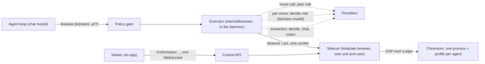

# The browser

How `browser.do` works: the two processes, how to set them up, the tool the
agent sees, the loop that drives a page, what each model is shown so that it
can decide, and how a person approves, watches or takes over.

## Contents

1. [Concepts](#1-concepts)
2. [Setting it up](#2-setting-it-up)
3. [The tool](#3-the-tool)
4. [A run](#4-a-run)
5. [Extraction](#5-extraction)
6. [Who decides what](#6-who-decides-what)
7. [People](#7-people)
8. [The sidecar and Chromium](#8-the-sidecar-and-chromium)
9. [Events and troubleshooting](#9-events-and-troubleshooting)

## 1. Concepts

The agent never drives the browser. It states an intention once and gets a
short result back. A separate component does the clicking, mostly without a
generative model. An accessibility snapshot per step and one model turn per
click, as other browser agents do, would not fit an 8k context.



| Half | Runs in | Owns | Never has |
|---|---|---|---|
| Executor (`internal/browser`) | the daemon | intent → observe → moves, every model call, approvals, the trace, the one-run-at-a-time queue | a CDP connection |
| Sidecar (`holaclaw browser`, same binary) | its own process and user | Chromium processes, profiles, CDP, observation, input, screencast, downloads, the allow-list | provider keys, `auth.toml`, the database, a network listener |

The split is forced. Chromium can't run under the daemon's hardened unit:
`MemoryDenyWriteExecute` kills V8's JIT, `NoNewPrivileges` and
`RestrictNamespaces` stop Chromium's own sandbox, and `SystemCallFilter`
together with that sandbox's own seccomp policy breaks its zygote. Relaxing the
daemon to suit a browser that parses hostile pages would weaken everything
else, so only the sidecar's unit lifts those, and it caps the browser at
`MemoryMax=2G` and `TasksMax=512` ([security.md](security.md#hardening)). A
renderer compromise lands in a process that holds no secrets.

`--no-sandbox` is never used. When Chromium's sandbox can't start, the browser
fails to launch, every call to it answers with an error, and `holaclaw check`
says why (`BRW003`).

## 2. Setting it up

The browser is off until you turn it on: add a `[browser]` table to
`config.toml`, or set `HOLACLAW_BROWSER_ENABLED=true`. Once it is on, every
agent gets `browser.do`, unless its `agent.toml` turns it off. The sidecar
needs Chromium, and Xvfb unless `headless = true`. How you set it up depends
on how HolaClaw runs.

**Fonts.** Chromium draws a page with the fonts installed on the system, and
text in a script that none of them covers comes out as empty boxes, in the
screenshots too. Every deployment below installs the same basic set: DejaVu,
Liberation (the same metrics as Arial, Times New Roman and Courier New, so a
page that asks for one of them keeps its layout), Noto Sans CJK and Noto
Color Emoji. On Debian these are `fonts-dejavu-core`, `fonts-liberation`,
`fonts-noto-cjk` and `fonts-noto-color-emoji`. Install the same four where
you install Chromium yourself; any other font you install system-wide is
used as well, except in the image, which has only these.

**In a container** ([deployments/container.md](deployments/container.md)):
nothing to do. The `latest` image holds Chromium, Xvfb and the fonts, and sets
`HOLACLAW_BROWSER_ENABLED=true`, and the entrypoint runs the sidecar as its
own user next to the daemon. Chromium's sandbox needs the `--security-opt
seccomp=unconfined` of the guide's `docker run`. `install.sh` asks whether to
set it up. To go without the browser, run the `slim` image, which has no
Chromium, and drop the flag; or pass `-e HOLACLAW_BROWSER_ENABLED=false` to
`latest`.

**As a systemd service** ([deployments/linux.md](deployments/linux.md)), the
sidecar runs as a second user, `holaclaw-browser`, under its own unit,
`holaclaw-browser.service`, which is in the release next to `holaclaw.service`.
`install.sh` sets it up when you answer yes, or with `--service --browser`;
it installs Chromium and Xvfb with apt when they are missing, and the fonts.
To do it by
hand, first add an empty `[browser]` table to `/etc/holaclaw/config.toml`
(`sudoedit`, as in section 6 of the guide): its socket defaults to the
unit's, `/run/holaclaw-browser/browser.sock`. Then, from the directory you
downloaded the release into (section 2 of the guide, with `$base` set):

```
curl -fL --remote-name-all "$base/holaclaw-browser.service" "$base/SHA256SUMS"
sha256sum --check --ignore-missing SHA256SUMS
sudo apt install chromium xvfb \
  fonts-dejavu-core fonts-liberation fonts-noto-cjk fonts-noto-color-emoji
sudo useradd --system --home-dir /var/lib/holaclaw-browser --shell /usr/sbin/nologin holaclaw-browser
sudo usermod -aG holaclaw-browser holaclaw        # the daemon reaches the sidecar's 0660 socket
sudo chgrp holaclaw-browser /etc/holaclaw && sudo chmod 750 /etc/holaclaw
# the sidecar loads the config and the agents:
sudo chgrp -R holaclaw-browser /etc/holaclaw/config.toml /etc/holaclaw/agents
sudo chmod -R g+rX /etc/holaclaw/config.toml /etc/holaclaw/agents
sudo install -m 644 holaclaw-browser.service /etc/systemd/system/holaclaw-browser.service
sudo systemctl daemon-reload
sudo systemctl enable --now holaclaw-browser
sudo systemctl restart holaclaw
```

The sidecar loads the whole configuration, so it needs to read `config.toml`,
the agents and, once you add one, `channels.toml`, which `init` keeps to the
daemon. Everything else in `/etc/holaclaw` stays the daemon's alone: the
database, the token and the secrets keep their `0700` and `0600` modes. Give
the group read access again to an agent you add later.

**On NixOS** ([deployments/nix.md](deployments/nix.md)),
`services.holaclaw.browser.enable = true` creates the user and the unit, with
Chromium and Xvfb, adds the fonts to `fonts.packages`, and gives the config
directory to the `holaclaw-browser` group. Make `config.toml`, the agents (and `channels.toml`, if you add one)
readable by that group, and add the `[browser]` table, as above.

**As your own user** (section 9 of
[deployments/linux.md](deployments/linux.md#9-as-your-own-user)),
`install.sh --user --browser` runs the sidecar as a second user service,
`holaclaw-browser`, once Chromium and Xvfb are installed. By hand, run it in a
terminal of its own. Install Chromium, Xvfb and the fonts with your package manager,
then put the socket in a directory you own, written out, as TOML doesn't
expand variables (`echo $XDG_RUNTIME_DIR` prints it):

```toml
[browser]
socket = "/run/user/1000/holaclaw-browser.sock"
```

Start the sidecar before the daemon, with the same config directory:

```
holaclaw browser                            # in a terminal of its own; then `holaclaw run`
```

The sidecar and the daemon then run as the same user, so a compromised
renderer is not kept away from `auth.toml` as it is with the two users of a
system install or a container. Use it to try the browser out.

### Configuration

```toml
# config.toml
[browser]
# enabled  = true                # the default once the table exists; env HOLACLAW_BROWSER_ENABLED wins
# socket   = "/run/holaclaw-browser/browser.sock"   # the default
# binary   = "/usr/bin/chromium" # an absolute path, only when Chromium is not on PATH
# headless = false               # true on hosts without X; a window on Xvfb by default

[providers.openrouter]
sort = "throughput"              # the route dominates move-call latency
```

```toml
# agents/<name>/agent.toml
[browser]
# enabled = false                # keep this agent off the browser
# allow   = ["example.com"]      # enforced in the sidecar; unset = any site

[models]
decide = "jev"                   # a decision model; without it the chat model answers every question, slowly
plan   = "planner"               # optional: the chat model that writes the moves
vision = "planner"               # optional: the screen read and the look rung
```

`HOLACLAW_BROWSER_ENABLED` wins over `enabled`; empty counts as unset, and a
value that isn't a boolean is a config error. With the browser on, every agent
has `browser.do` without listing it in `tools`. Listing it (as `browser.do` or
`browser`) while the browser is off, or in an agent that turned it off, is a
config error. `decide` must name a decision model (`api = "decisions"`), and
`plan` and `vision` a chat model. The roles are in [models.md](models.md#4-roles).

`holaclaw check` covers the browser when it is on:

| Rule | Level | Checks |
|---|---|---|
| `BRW001` | error | a browser binary is found, and is 136 or newer |
| `BRW002` | error | Xvfb is on `PATH` when `headless` is off |
| `BRW003` | error | the kernel lets Chromium's sandbox start (user namespaces, AppArmor) |
| `BRW004` | warning | the sidecar answers on its socket; skipped with `--offline` |
| `BRW005` | warning | an agent with `browser.do` has no `browser.allow` |
| `BRW006` | warning | an agent with `browser.do` has no `decide` role |

## 3. The tool

`browser.do(intent, url?)` is the whole browser as one tool call. The agent
writes the whole request in the intent ("find the price of X on Y and read
it"), up to 2000 bytes; a longer one is refused, not cut. `url` is an optional
start, `http` or `https`: an entry page or a direct image URL. The schema fits
the 150-token cap every tool schema has, and its description says the browser
reads what a page shows, images and charts included, so the chat model
doesn't treat a picture as a dead end.

What comes back is compact and never a snapshot, at most 8000 bytes. Empty
lines are left out; the `screenshot` line is always there.

```
outcome: done | failed | blocked
answer: <what was asked for, at most 4 KB>
notes: <fixed words, and the page's title and URL where it stopped>
url: <where the browser ended up>
title: <its title>
downloads attached: <names>
screenshot: true | false
```

How a run ends:

| Outcome | When |
|---|---|
| `done` | the answer was read off the page (§5) |
| `failed` | it ran out of moves, steps (40) or time (4 minutes); it gave up after recovering (§4); or its start page could not be opened, or opened on nothing to act on |
| `blocked` | it needed something it couldn't get: a site off the allow-list, a refused approval, or a person for a login, captcha or 2FA when nobody took over (§7) |

- **Who gets it.** Every agent, once the browser is on (§2), unless its
  `agent.toml` turns it off. Its risk class is `external`
  ([security.md](security.md#4-tools-and-policies)). A guest, pending senders
  included, is refused when it calls it.
- **Tainted.** The result is untrusted like `fetch` output: the answer is
  page-derived, shown to a person and never followed as an instruction. The
  taint scorer then grades it, so an ordinary answer doesn't arm the guard for
  the rest of the turn while a steering one does. Without a decision model
  every result counts as steering
  ([security.md](security.md#7-untrusted-content)).
- **Downloads** become attachments: up to 10 per run, 20 MiB each, stored as
  blobs and never executed. A larger one, or one that can't be fetched, is
  dropped.
- **A screenshot** of the page a `done` run ended on is attached as
  `screenshot.jpg` when the request asks for one, or when the answer is
  clearer as a picture: a chart, a map, a seating plan (§5). It is one JPEG of
  what the tab shows, stored as a blob after the downloads, with the same
  20 MiB cap. `screenshot: true` says it is attached; `false` says there is
  none, or that it was over the cap or could not be stored. It is tainted
  like the answer. The chat model is told only that it is attached: the image
  is not passed to it.

That is the entire interface between the two halves. The chat model decides
*whether* and *what* to ask the browser. Nothing about pages, refs or moves
ever reaches its context, which is what keeps a browsing turn inside an 8k
window.

## 4. A run

There is no plan written before the first page: a plan written blind
completed no real task. The run is a loop, each hop a trace event.

**Where a run starts.** Every run opens on a page of its own: a new blank tab
replaces the agent's tabs, then the run goes to its start URL, if it has one.
The profile is kept, logins and all. What the last run left behind is not:
its page, its back-button history, an open dialog. A start URL that renders
no title and nothing to act on fails the run at once, and one off the
allow-list blocks it. A run without a start URL begins on the blank tab and
its first move goes somewhere.

An agent has one browser, so its runs go one at a time, whichever session
asked. A run that has to wait for another, say a chat turn behind a
background task, says so on the trace straight away (`browser.step` with
`held: queued`). `holaclaw chat` shows that line at every verbosity.

**Limits.** A run is bounded by 40 steps and a 4-minute deadline. A step is
any action the sidecar runs: the navigation to the start URL, a click, a
pick, a navigation of a recovery. The deadline starts once the run has the
browser, so time spent queued doesn't count.

```
observe ─► [thin page? read the screen] ─► move call ─► for each move:
   bind and commit class (one decide call) ─► approval? ─► act ─► wait ─► observe
   ─► verify (decide: effect, goal) ─► worked: next queued move
                                     ─► failed: drop queue, history line, move call
   goal ≥ 0.6 or "done" ─► extract ─► answer
   stuck ─► strategy (decide) ─► retry_other | restart | deeplink | look | give_up
```

**Observe.** The sidecar's observation is small by construction: URL, title,
open dialogs and alerts, a shortlist of candidate elements with opaque refs,
and 4 KB of page text read around the element the last move touched rather
than from the top. A page that reports itself loading gets up to three
10-second waits before anything is decided on it.

- **Refs.** `g3r7` is observation 3, element 7 in document order among every
  candidate on the page. A stale ref can never resolve to whatever is seventh
  now.
- **The shortlist** is 25 candidates: what the last move put on the screen
  first, then what is visible, then form controls before buttons before
  links, then document order. It widens to 64 on the read after a move on an
  element that isn't editable or has a popup, unless the page navigated,
  since such a move tends to open something. While a modal is up only its
  controls are listed, so a cookie banner is dismissed before anything behind
  it is tried.
- **Each candidate** carries what the page itself says about it: role, name,
  value, `expanded`, `haspopup`, `invalid`, `required`, `editable` (false for
  a read-only field), `disabled`, `focused`, `offscreen`, `description`, `in`
  (the element it belongs to, so options nest under their combobox), `new`
  (not on the previous observation), and `secret` for password and card
  fields, whose value and description are never filled in.
- **Hand-cursor elements.** An element with no role and no handler, but a
  pointer cursor and a short name, a calendar's day cell say, is admitted as a
  button when it is new on the same tab and URL. It stays while it stays on
  the page. At most 40 are admitted per observation, so static furniture
  doesn't crowd the list.

**Move.** One text call, role `plan` falling back to `chat`, is shown that
page and a short history of what has been tried, and answers strict JSON: one
to three moves from a closed set (`click type select scroll back wait
navigate key`), each with a ref of *this* observation or a few words for the
decision model to bind, and one sentence of what it expects; or `done`; or a
blocker that needs a person. Each attempt has 30 seconds; an unreadable answer
is retried once. A timeout, or a second unreadable answer, counts as a call
that found nothing to do.

Every move is checked against the closed set, a `key` move against a closed
set of key names, and a `navigate` must be `http` or `https`; a move that
fails is dropped. A ref the observation never offered is cleared, and the
move is kept only if it has words for the decision model to bind. The
allow-list is the sidecar's (§8). Page text sits inside a fence that can never
widen the action set. The prompt tells the model to take typed values from
the request, never from the page and never a credential; that is an
instruction, not a check.

**Verify.** The decision model (`decide`) answers closed questions around each
move:

- **Before it**, in one call, which element a move means when it named none,
  and what a move commits, asked for every click, a type or select that
  submits, and the Enter key. A bound element needs a confidence of 0.6, and
  an unreadable commit answer drops the move. A move that needs neither is
  not asked about.
- **After it**, in one call, `effect` (did the before/after difference match
  the expectation) and `goal` (is the request satisfied by what the page shows
  now). `loading` is added only when nothing on the page changed at all, the
  one case the browser's own wait can't tell from a slow site.

A move whose effect clears 0.5 is followed by the next queued move with no
text call. One below it drops the queue and puts the failure in the history
for the next move call, unless `loading` is 0.6 or more and `goal` is under
0.6: then the run waits a moment and reads again with its queue intact, up to
three times. The queue also drops when the URL changes. After every action
the queued moves' refs are matched again by role and name, and the queue is
cut at the first one that matches none, or more than one.

**Wait.** Never a sleep the executor guesses at. One `ActWait`, answered by
the sidecar in two stages: the page's `load`, then a quiet window in which the
document is read again and again, a short pause apart (40 to 250 ms), until
two readings agree (same resources, text length and element count,
`readyState` complete). After an action the sidecar first waits for the
document to change, then for it to go quiet. The executor's own waits are
`browser.step` events but cost no step; a model's `wait` move costs one.

**Type-and-pick, open-and-pick.** An autocomplete commits on the choice, not
the characters. After a `type` or `select` that leaves the box expanded or
adds options under it, or a `type` or `select` aimed at a box that isn't
editable (it has a popup, or is a combobox, listbox, textbox or searchbox),
which the executor turns into a click that opens it, the executor waits for
the list. It offers the decision model the suggestions the move opened, with
"none of them" as a choice, clicks the one chosen and reads the box again.
The move worked only when the box is closed and holds a value; the queued
move behind it still stands. A `type` or `select` into such a box never
submits with Enter, so the pick comes first. A `type` the box didn't take is
retried as a click.

A move that opens a dialog, or puts new controls on the screen with no list to
pick from, drops the queue behind it with a fixed history line, since the
queued moves were decided on a page without them.

**Budget and progress.** The move budget starts at 6 calls and grows by three
whenever it runs out while the last progress is no more than two calls back,
up to 15. Progress is a fact about the page or the run, never a move's account
of itself: an address never visited, a `goal` higher than any before by 0.1,
an alert or invalid mark gone after a move, or a suggestion taken. A calendar
that opens and closes scores 0.9 every time and is not progress.

**Stuck and recovery.** A tracker keeps the last six page fingerprints, the
high-water mark of `goal`, the elements moves have failed on and the addresses
visited. After a verified move below the goal floor, or a move call that found
nothing to do, it reports the first of four reasons that holds, each once per
run:

- `circling`: an A, B, A, B or A, A, A pattern of pages over at least two
  move calls;
- `repeating`: moves failed twice on the same element;
- `stalled`: `goal` hasn't risen for three move calls;
- `nothing`: two move calls in a row found nothing to do.

The run says so on a `browser.step` (`held: stuck`, `why`) and asks the
decision model one `strategy` question over a closed set:

- `retry_other`, with a fenced "do not try again" list;
- `restart`: back to the first page the run read, history collapsed to one
  line. Offered only once the run has read a page;
- `deeplink`: one generative call for an address on this site, validated like
  any navigate. An address off the allow-list blocks the run;
- `look`: the vision rung, a screenshot described in at most eight words and
  turned into a click the decision model binds. Offered once per run, and only
  with a `vision` role;
- `give_up`: offered to a person first when somebody is watching (§7), else
  the run ends `failed`.

An unreadable answer, a `deeplink` that yields no `http` or `https` address,
or a `look` that fails becomes `retry_other`. At most two recoveries per run,
a `give_up` included; the next stuck reason gives up without asking. A
restart keeps the addresses already seen, so going back is not progress.

## 5. Extraction

When `goal` clears 0.6 or the move call says `done`, the answer is read off
the final page, at most 4 KB of it, in this order:

1. **Selection** (`decide`, skipped without that role). The page is cut into
   at most 5000 spans of 120 bytes. On a page of more than 200 spans, the ones
   the request's own words appear in come first, with the spans around each
   hit (two before, eight after, because a list follows its heading), then the
   rest up to 200, all in page order. One `choice` picks a span, with a
   `covered` score that must reach 0.7 and a `many` score: a request for
   several things (`many` 0.5 or more) is never answered by selection; it goes
   to the chat rung, told to list.
2. **Thin page.** A page with under 80 bytes of text goes to the screen rung
   (4), and when a screen read runs, its answer is final. Without a model that
   reads images, or when the screenshot or its call fails, the page goes to
   the chat rung like any other.
3. **Chat** (`chat`): reads the whole page as the sidecar capped it (32 KB),
   its elements and alerts included, told when it was cut, and writes one
   short answer. Three sentinels are not answers. `not found` goes into the
   history and the run tries again while it has budget. `partial` sends the
   run back once per page and settles the second time with the caveat in the
   notes. `look` says the answer is most likely in a picture.
4. **Screen** (`vision` role, else the `chat` model when its entry says
   `vision = true`): one screenshot and one call with the image, the request,
   and the page's URL and title, no page text. Its triggers are recorded as
   `screen_why`: `thin`, `look` (the chat rung asked), `not_found` (one retry
   after a miss). One screen read per extraction. A `look` with no model that
   reads images, or a screen read that finds nothing, counts as `not found`.

The loop also tries to answer from a thin page before it spends a move on it,
at the start and after a navigate or click lands on one, since neither loop
exit is reachable on an empty observation. It does so only with a model that
reads images, on an `http` or `https` page, and not twice in a row on the same
page.

`not found` and `look` are matched at either end of an explanation, since a
model asked for one word explains itself as well, and never in the middle of a
sentence. `partial` is matched only as the first word. The Spanish `no
encontrado` and `mirar` count too. The choice to look is the reading model's,
never a list of words the request might contain.

Once the answer is read, the run asks one more question, once: should the
answer come with a screenshot of the page? Yes when the request asks for one,
or when the answer is clearer as a picture: a chart, a map, a seating plan.
The decision model answers (`picture`, 0.6 or more); without a `decide` role
the chat model answers `yes` or `no`. It is a model's call, never a list of
words the request might contain. On a yes the run returns one screenshot of
the final page, reusing the one a screen read took of it. If the question
can't be answered or the screenshot fails, the run is `done` all the same,
without one. A `failed` or `blocked` run returns none.

`browser.task.finished` carries `extract_by` (`selection`, `chat`, `screen`),
`screen_reads`, `screen_why` and `screenshot` (whether the run returned one).
Neither the page text nor a screenshot reaches a log, a trace or an event.

## 6. Who decides what

The rule of the whole design, and the reason it fits a small context:

| Owner | Decides | Given |
|---|---|---|
| Rules and the sidecar | facts: what is on the page, whether it changed, whether a box is expanded or invalid, whether the run is circling, whether a page is thin, whether a move is inside the closed set and the allow-list | the DOM, the accessibility tree, the layout, the run's own history |
| Decision model (`decide`) | judgments among things offered: which element, what a move commits, did it work, is the goal met, is the page loading, which suggestion, which strategy, which span, does the answer want a picture | a fenced state (request, page, history) and closed criteria; never free text back |
| Generative model (`plan` / `chat` / `vision`) | only what must be written: the moves, a deep-link URL, the prose answer, a control's description | the fenced page, the history, the request; strict JSON or one short answer |
| The main agent (`chat`) | whether to browse, what to ask for, what to do with the answer | the tool's description and the compact result, tainted |

Without a `decide` role the chat model answers the decision model's questions,
slowly, and selection is skipped.

Data crosses these lines in one direction and one shape. The page reaches a
model only inside a fence, capped, with its refs opaque. A model's answer
reaches the page only through the closed action set with a ref the sidecar
minted. Nothing a model says drives input by coordinates.

## 7. People

A person comes into a run in three ways: approving a risky step, taking over
the browser, and watching it.

### Risky steps

Before a move that commits something (a click, a type or select that submits,
the Enter key), the decision model classifies it: `none`, `purchase`, `send`
(posts, messages, emails, forms to people), `delete` (deletes or cancels
something) or `account` (credentials or account settings). An answer it can't
read drops the move. Anything but `none` is an ordinary tool approval for
`browser.do` ([security.md](security.md#5-approvals-and-grants)), so every
channel and app shows it. The approval reads in fixed words, the class, the
action and the ref, never an element's name or a typed value:

```
browser: a move classified purchase: click on g4r2
```

Every risky step asks again, whatever the last answer was. A denied or
expired approval ends the run `blocked`. A detached run's step approval is
filed and waits like any other, until it expires or the run's deadline ends
it.

### Takeover

A takeover hands the browser to a person in the live view, to sign in, pass a
captcha or get the run past something it can't.

- **When a run asks.** A login, captcha or 2FA the move call reports always
  asks, and waits. A `give_up` asks only while somebody is watching the live
  view; nobody watching, the run ends `failed` at once. A run gets at most two
  takeovers. A detached run (a scheduled task) never asks: it ends `blocked`
  on a login, captcha or 2FA, and `failed` on a give-up.
- **How long.** A takeover the run asked for times out after 5 minutes. A
  login, captcha or 2FA that nobody took, or that was refused, ends the run
  `blocked`; a give-up nobody took ends it `failed`.
- **The lock.** Taking over needs admin scope. While a person holds it only
  their input reaches the page; everyone else's is dropped. The run waits,
  making no observation and retrying any action every second, and handing
  back resumes it.
- **Chat channels** get the takeover request, a fixed sentence and a
  screenshot, in the conversation the run came from when an owner or admin
  started that turn. Driving needs an app.
- **What a person types never enters a prompt, a message or a trace.** Input
  goes client → daemon → sidecar → CDP and is not logged anywhere. There is no
  credential vault: secrets are typed by their owner through a takeover and
  live on only as the site's own cookies in the agent's profile.

### The live view

A person watches an agent's browser from an app.

| Endpoint | Scope | What it does |
|---|---|---|
| `GET /v1/browser/sessions` | client | the agents' running browsers; a user's token sees the agents that user may use |
| `POST /v1/browser/sessions/{agent}/view` | client | a ticket for the stream: single-use, bound to the agent and the user, valid 60 seconds |
| `GET /v1/browser/sessions/{agent}/stream?ticket=` | the ticket | the API's one WebSocket |
| `POST /v1/browser/sessions/{agent}/takeover`, `…/release` | admin | take the lock, and hand it back; `not_found` when the agent has no browser running |
| `GET /v1/browser/viewer` | client | a minimal viewer page, for testing |

- **The stream.** A browser can't set an auth header on a WebSocket, so the
  ticket goes in the URL. Binary JPEG frames go out (quality 60 by default,
  30 to 80, up to 20 fps), and pointer, wheel, key, text, tab and quality
  events come in. A watcher that hasn't acknowledged its last frame skips
  frames, so a slow viewer never slows the browser.
- **The activity stream.** Watchers also see what the run does: the
  shortlists with names and values (secret fields empty), the alerts, and
  each action and its target. Never typed text or keys.
- **Who may watch.** A user of the agent; guests may not. Admin scope and the
  local socket see every agent.

## 8. The sidecar and Chromium

**The binary.** `browser.binary` when set, and then only that path. Otherwise
the first of `chromium`, `chromium-browser`, `chrome-for-testing`,
`google-chrome` and `google-chrome-stable` on `PATH`. Nothing is downloaded:
you install the browser and your distribution patches it. Chromium 136 or
newer is supported. An older one is reported, not refused: the sidecar still
launches it, while `holaclaw check` (`BRW001`), the sidecar's health answer
and the daemon's log at start say it is too old. With no browser at all the
sidecar still runs, and answers every call with an error.

**A window by default.** Chromium runs with a real 1280×1200 window on a
virtual display the sidecar starts for each agent (`Xvfb`, no TCP, its own
X authority file): a windowed browser is what sites expect, and native widgets
such as select popups exist. `headless = true` uses `--headless=new` on hosts
without X, and starts no display.

**Profiles follow agents**, like long-term memory: one Chromium and one
`--user-data-dir` per agent, under `<state>/profiles/<agent>/`. The state
directory is `holaclaw browser --state` when given, else the unit's
`StateDirectory`, else `<data_dir>/browser`. A browser starts on first use and
stops after 10 minutes idle. One that crashes comes back on the next call that
needs it. At most four run at once; a fifth agent's run fails with an error
rather than waiting. Agents never share cookies or logins, and every user of
an agent shares its logins, the same boundary as its workspace. Chromium
stores saved passwords with `--password-store=basic`: they are protected by
the profile's directory and the sidecar's own user, not a keyring.

**CDP rules:**

- CDP runs over `--remote-debugging-pipe`: no TCP port.
- `Runtime.enable`, `Console.enable` and main-world script are refused by the
  CDP layer itself. Pages are read through `DOM`, `DOMSnapshot` and
  `Accessibility`; anything else runs in an isolated world.
- Clicks and keys go through `Input.dispatch*`, so the page sees
  `isTrusted = true`. Text goes through `Input.insertText` in short chunks,
  after `DOM.focus`.
- Chromium starts without automation flags and with
  `--disable-blink-features=AutomationControlled`, so `navigator.webdriver` is
  false. It also gets `--use-angle=swiftshader` (software WebGL on Xvfb) and
  `--disable-features=Translate,MediaRouter`.
- No fingerprint spoofing, no proxy rotation, no captcha solving. HolaClaw
  browses as its owner, from its owner's machine.
- Pacing: a curved pointer path, a 60 ms dwell, 60 to 130 ms between chunks
  of text, ±25% jitter on every pause, and at most one action per agent per
  100 ms.
- Chromium's environment is reduced to an allow-list of variables.

The refused methods, trusted input and `navigator.webdriver` are each held by
a test against real Chromium.

**The allow-list.** `browser.allow` in an agent's `agent.toml` limits where
its browser may go; unset or empty means any site, with the policy gate, taint
and step approvals still in force. It is enforced in the sidecar, never in a
prompt: on every document request of every tab, popup and frame, before a
navigate, and on the URL a page settles on. A popup that was refused is
closed, and a page that left the list is walked back. A refused navigation
ends the run `blocked`.

**Pages and downloads.** A JavaScript dialog is dismissed before the next
action. Downloads are kept by the sidecar under an id, never the name the
site suggested: 50 MB per file and 200 MB per agent. A file is deleted once
the daemon has fetched it. One the daemon never fetched is deleted when the
agent's browser closes or the sidecar stops, or, once it is an hour old, the
next time the agent's browser opens: nothing sweeps them on a timer.

**The socket** is `0660`, reached by the daemon through the
`holaclaw-browser` group; file permissions are its only authentication. The
sidecar logs one line per request (method, path, status, time, and the agent
except on the stream), never a body.

## 9. Events and troubleshooting

- `browser.task.started`: `agent`, `detached`, `decider` (`decision` or
  `chat`), and `queued_ms` when the run waited for another run of the agent.
- `browser.task.finished`: `outcome` (`error` when the executor itself
  failed), `steps`, `rungs` (how often each rung ran), `move_budget`,
  `move_calls`, `generative_calls`, `decision_calls`, `waits`, `recoveries`,
  `downloads`, `answer` (whether there was one), `extract_by`,
  `extract_took_ms`, `screen_reads`, `screen_why`, `screenshot` (whether the
  run returned one), `took_ms`, the URL and
  title it ended on, and the usage over every call it made, chat and decision
  alike: `prompt_tokens`, `completion_tokens`, `cost_nanousd` (the calls that
  reported a price) and `unpriced_calls` (those that didn't), with
  `extract_prompt_tokens` and `extract_completion_tokens` for extraction alone.
- `browser.move`: one per move call, numbered `n`: each move's action, target
  and expectation, `done`, `blocked`, `dropped`, `retried`, `took_ms`, and
  that call's usage.
- `browser.step`: one action, numbered `n`: `action`, `ref`, `role`,
  `target` (ref and name), `effect_p`, `goal_p`, `load_p`, `risk`, `rung`,
  `took_ms`, `opened`, `panel`, the pick (`picked`, `pick_ref`,
  `pick_target`), and the URL when it changed. Also waits (`action: wait`,
  `until`, `quiet`), holds (`held: stuck`, `why`), recoveries
  (`action: recover`, `strategy`) and `held: queued` (`why: another_run`) for
  a run waiting for the browser.
- `browser.screenshot`: one per screenshot taken, whatever took it: `why`
  (`look` for the vision rung, `thin` or `screen` for a screen read of a page
  with or without text, `return` for the one a run returns, `takeover` for
  the one a chat channel gets with a takeover request), `size` in bytes,
  `took_ms`, the page's `url` and `title` (absent on a takeover's), and
  `attached` (whether it was returned to the agent). A screen read that is
  reused as the returned picture is one event, `attached`. Never the image,
  nor anything read off it.
- `browser.blocked`: `why`, one of `not_allowed`, `approval_refused`, `login`,
  `captcha`, `2fa` or `error` (a give-up offered to a person). A login,
  captcha or 2FA is reported when it is met, even if a takeover then gets the
  run past it.
- `browser.takeover.requested` (`agent`, `why`, `expires_at`),
  `browser.takeover.started` and `browser.takeover.ended` (`agent`,
  `user_id`).
- `browser.download`: `agent`, `name`, `size`.

The trace carries scores, refs, fixed words, counts, element names, the
moves' expectations and the URLs and titles a run passed through. Never page
text beyond those, typed values or pixels.

`holaclaw chat` shows a run as it happens: the task events and downloads at
`-v`, the moves, steps and screenshots at `-vv`, a queued run at every level. `holaclaw
trace` lets you walk one afterwards, with each step's rung, duration and the
token counts.

**Troubleshooting:**

- **Move calls are slow.** Check the provider's routing key
  (`sort = "throughput"`) before adding a `plan` role: the route dominates
  latency, not the model.
- **Consent banners and bot walls.** A login, captcha or "are you a robot"
  page asks for a takeover. Nothing else is site-specific.
- **One run in detail.** `holaclaw trace <id>` has every step's rung,
  duration and token counts.
- **The browser doesn't start.** `holaclaw check` names the cause: no binary
  or one too old (`BRW001`), no Xvfb (`BRW002`), a sandbox the kernel won't
  allow (`BRW003`), or no sidecar on the socket (`BRW004`).
